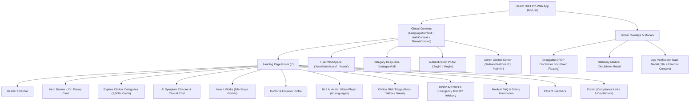

# Health Orbit Pro™ — Complete UI/UX Wireframe & Layout Specification
**Version:** 2.4.0 • **Platform:** Responsive Web Application (Mobile, Tablet, Desktop, 2K/4K)  
**Theme:** Clinical Emerald & Clean Slate (`#0D5C3A`, `#F4F9F6`, `#FFFFFF`, `#0F172A`)  
**Tagline:** *India's Own Co-Intelligence Healthcare AI — Where Human Experience Meets AI*

---

## 1. Information Architecture & Sitemap



---

## 2. High-Level Master Layout Grid

```text
+----------------------------------------------------------------------------------------------------+
|  HEADER / NAVBAR (Sticky, z-50, Glassmorphism, 72px Height)                                        |
|  [Logo: Health Orbit Pro™]    [Home]  [Symptom Checker]  [Categories v]  [About]  [Search]         |
|                                                     [🌐 Lang: EN/HI/MR/GU/BN/AR] [⚠️ Disclaimer] [Sign In]|
+----------------------------------------------------------------------------------------------------+
|                                                                                                    |
|  HERO SECTION (16:9 Aspect Ratio / Full-Width Container, max-w-[1520px])                          |
|  +----------------------------------------------------------------------------------------------+  |
|  | [Health Orbit Pro™]                 | [High-Resolution Authentic Clinical Doctor Banner]     |  |
|  | India's Own Co-Intelligence AI       | - Dr. Pratap Madhukar sitting at clinic desk           |  |
|  | "Where Human Experience Meets AI"    | - Bookshelf, blinds, stethoscope, clinical attire      |  |
|  |                                      |                                                        |  |
|  | [🔍 Enter symptoms, medicine, test..] | +----------------------------------------------------+ |  |
|  | [Start Clinical Assessment ->]       | | 🩺 Dr Pratap Madhukar                              | |  |
|  | [🛡️ DPDP Disclaimer Pill]            | | Senior Physician | Family Health Mentor            | |  |
|  |                                      | | Harvard Certified | [38 Years Experience Pill]     | |  |
|  |                                      | +----------------------------------------------------+ |  |
|  +----------------------------------------------------------------------------------------------+  |
|                                                                                                    |
+----------------------------------------------------------------------------------------------------+
|  EXPLORE BY CLINICAL CATEGORY (10 Interactive Domain Cards with 1,000+ Health Cards Showcase)      |
|  [🩺 My Symptoms (1,000+)] [👩 Women's Care] [👨 Men's Health] [👶 Child Care] [🧓 Senior Health]   |
|  [💊 Medications & Safety] [🧪 Lab Tests]   [🥗 Clinical Diet] [🧠 Mental Health] [❤️ Chronic Care]|
+----------------------------------------------------------------------------------------------------+
|  AI SYMPTOM CHECKER & INTERACTIVE CLINICAL ASSISTANT (Dedicated In-Page Workspace)                |
|  +---------------------------------------------------+ +----------------------------------------+  |
|  | Clinical Chat Conversation Stream                 | | Real-Time Clinical Triage Assessment   |  |
|  | - Patient Symptom Queries                         | | - Risk Level: 🟢 Green / 🟡 Yellow / 🔴 |  |
|  | - Plain-Language Medical Guidance                 | | - Recommended Questions for Doctor   |  |
|  | - Doctor Preparation Checklist                    | | - Emergency Alert (108 / 112 Notice) |  |
|  | [ 🎙️ Speak Symptoms ] [ Type your symptoms... ] [Send]| | [ Export Consultation Prep PDF ]     |  |
|  +---------------------------------------------------+ +----------------------------------------+  |
+----------------------------------------------------------------------------------------------------+
|  HOW IT WORKS: LIFE-STAGE HEALTH PORTALS                                                           |
|  [ 1. Symptom Input ] ---> [ 2. Tri-Color Triage ] ---> [ 3. Health Library ] ---> [ 4. Doctor Prep] |
+----------------------------------------------------------------------------------------------------+
|  DOCTOR PROFILE & CLINICAL TRUST SECTION                                                           |
|  [ Photo & Bio: Dr. Pratap Madhukar ] [ 38+ Years Hospital Experience ] [ Harvard Certified Coach ]|
+----------------------------------------------------------------------------------------------------+
|  16:9 AI TALKING-AVATAR WELCOME & ONBOARDING VIDEO (6-Language Player)                             |
|  +----------------------------------------------------+ +----------------------------------------+  |
|  | 16:9 Cinematic Video Player Frame                  | | Interactive Video Chapter Timeline     |  |
|  | [🤖 AI Clinical Avatar • Supervised by Dr. Pratap] | | 1. Welcome & Platform Mission (0:00)   |  |
|  | [Alternating Full Doctor & Site Walkthrough + PiP] | | 2. AI Symptom Checker Demo   (0:18)   |  |
|  | [Subtitles: Live phrase sync with Arabic RTL dir]  | | 3. 1,000+ Health Cards Library(0:38)   |  |
|  |                                                    | | 4. Personal & Family Portals (0:56)   |  |
|  | [▶️ Play] [⏮️ Replay] [🔊 Mute] [0:45/1:55] [1.0x] [⛶]| | 5. Multilingual Selection    (1:14)   |  |
|  | [Language Selector: HI | EN | MR | GU | BN | AR]   | | 6. DPDP Privacy & Emergency  (1:28)   |  |
|  +----------------------------------------------------+ | 7. Closing Doctor Farewell   (1:44)   |  |
|                                                         +----------------------------------------+  |
+----------------------------------------------------------------------------------------------------+
|  CLINICAL RISK LEVELS SECTION (Tri-Color Emergency & Urgency Spectrum)                             |
|  [ 🔴 RED: Immediate Emergency (108/112) ] [ 🟡 YELLOW: Medical Consult ] [ 🟢 GREEN: Self-Care & Lifestyle ]|
+----------------------------------------------------------------------------------------------------+
|  DPDP ACT 2023 COMPLIANCE & CLINICAL GOVERNANCE ADVISORY                                           |
|  - Zero Third-Party Tracking • Local-First Session Encryption • No Medical Diagnosis Guarantee     |
+----------------------------------------------------------------------------------------------------+
|  FREQUENTLY ASKED QUESTIONS (Accordion Grid)                                                       |
|  [+] Is Health Orbit Pro free to use?              [+] Can this replace an in-person doctor?       |
|  [+] How does the AI Symptom Checker work?         [+] How is my personal health data protected?   |
+----------------------------------------------------------------------------------------------------+
|  PATIENT FEEDBACK CARD & FOOTER                                                                    |
|  [⭐ Rating & Feedback Form]                                                                       |
|  Footer: Navigation Links • Legal • Disclaimers • Emergency Helplines 108/112 • DPDP 2023 Notice    |
+----------------------------------------------------------------------------------------------------+
|  [📌 FLOATING DRAGGABLE DPDP DISCLAIMER BOX] (Draggable pill/box pinned bottom-left / bottom-right)|
+----------------------------------------------------------------------------------------------------+
```

---

## 3. Detailed Component Wireframes

### 3.1 Header / Navigation Bar (`Header.jsx`)

```text
+-----------------------------------------------------------------------------------------------------------------------+
|  [Logo]                                                                                                               |
|  +---+ Health Orbit Pro™                                                                                              |
|  | + | India's Co-Intelligence AI                                                                                     |
|  +---+                                                                                                                |
|         [ 🏠 Home ]   [ 🩺 Symptom Checker ]   [ 📑 Categories ▾ ]   [ ℹ️ About ]   [ 🔍 Quick Search ]               |
|                                                                                                                       |
|         [ 🌐 Language: EN ▾ ]   [ ⚠️ Disclaimer Modal ]   [ 👤 Sign In / Workspace ]   [ ☰ Mobile Hamburger (sm only)]|
+-----------------------------------------------------------------------------------------------------------------------+
|  Categories Dropdown Menu (on hover/click):                                                                           |
|  +-----------------------------------------------------------------------------------------------------------------+  |
|  | • My Symptoms (1,000+ Cards)   • Medications & Drug Guide      • Diagnostic Lab Tests    • Clinical Diet Guide  |  |
|  | • Women's Health & Maternity   • Men's Preventative Health     • Child & Infant Care     • Senior Citizen Care  |  |
|  +-----------------------------------------------------------------------------------------------------------------+  |
+-----------------------------------------------------------------------------------------------------------------------+
```

### 3.2 Hero Banner Section (`Hero.jsx`)

```text
+-----------------------------------------------------------------------------------------------------------------------+
| <section className="relative w-full overflow-hidden bg-white">                                                        |
|                                                                                                                       |
|  +-- [Banner Container: Aspect Ratio 3:1 Desktop / 16:9 Tablet / Stacked Mobile] -----------------------------------+  |
|  |                                                                                                                  |  |
|  |  LEFT OVERLAY CONTENT:                                   RIGHT CONTENT (Photorealistic Clinic Setting):          |  |
|  |                                                          - Clean Physician Office Background                     |  |
|  |  [Badge: 🇮🇳 India's Own Co-Intelligence Healthcare AI]    - Dr. Pratap Madhukar seated at consultation desk       |  |
|  |                                                          - Bookshelf, window blinds, stethoscope, lab coat       |  |
|  |  Health Orbit Pro™                                                                                               |  |
|  |  Where Human Experience Meets AI.                                                                                |  |
|  |                                                          +----------------------------------------------------+  |  |
|  |  A clinical-grade triage assistant supervised by         | 🩺 Dr Pratap Madhukar                              |  |  |
|  |  senior physicians with 38+ years experience.            | Senior Physician | Family Health Mentor            |  |  |
|  |                                                          | Harvard Medical School Certified Wellness Coach    |  |  |
|  |  [ 🔍 Describe symptoms, medicine, or test...      ]     | [ ⭐ 38 Years of Clinical Experience ]             |  |  |
|  |                                                          +----------------------------------------------------+  |  |
|  |  [ 🚀 Check Symptoms Now ]   [ 📚 Browse 1,000+ Cards ]                                                          |  |
|  |                                                                                                                  |  |
|  |  [ 🛡️ DPDP Act 2023 Verified ] [ ⚠️ Not a Substitute for In-Person Diagnosis ]                                    |  |
|  +------------------------------------------------------------------------------------------------------------------+  |
+-----------------------------------------------------------------------------------------------------------------------+
```

### 3.3 Explore Clinical Categories (`ExploreCategories.jsx`)

```text
+-----------------------------------------------------------------------------------------------------------------------+
|  Section Header: "Explore Evidence-Based Medical Knowledge"                                                           |
|  Subtitle: Curated across 10 specialized health domains containing 1,000+ peer-reviewed health cards.                 |
|                                                                                                                       |
|  +------------------+  +------------------+  +------------------+  +------------------+  +------------------+         |
|  | 🩺 My Symptoms   |  | 💊 Medications   |  | 🧪 Diagnostic    |  | 🥗 Clinical Diet |  | 👩 Women's Health|         |
|  | 1,000+ Triage    |  | Dosage, Safety   |  | Normal Ranges,   |  | Therapeutic Food |  | PCOS, Pregnancy,  |         |
|  | Symptom Cards    |  | & Interactions   |  | Test Prep Guide  |  | & Nutrition      |  | Hormonal Health  |         |
|  | [Explore ->]     |  | [Explore ->]     |  | [Explore ->]     |  | [Explore ->]     |  | [Explore ->]     |         |
|  +------------------+  +------------------+  +------------------+  +------------------+  +------------------+         |
|                                                                                                                       |
|  +------------------+  +------------------+  +------------------+  +------------------+  +------------------+         |
|  | 👨 Men's Health  |  | 🧓 Senior Care   |  | 👶 Child Care    |  | 🧠 Mental Health |  | ❤️ Chronic Care  |         |
|  | Cardiac, Prostate|  | Mobility, Vitals |  | Pediatric Triage,|  | Stress, Sleep,   |  | Diabetes, BP,    |         |
|  | & Fitness        |  | & Chronic Memory |  | Immunization     |  | Anxiety Support  |  | Thyroid Tracker  |         |
|  | [Explore ->]     |  | [Explore ->]     |  | [Explore ->]     |  | [Explore ->]     |  | [Explore ->]     |         |
|  +------------------+  +------------------+  +------------------+  +------------------+  +------------------+         |
+-----------------------------------------------------------------------------------------------------------------------+
```

### 3.4 AI Symptom Checker & Clinical Chat Assistant (`ChatAssistantSection.jsx`)

```text
+-----------------------------------------------------------------------------------------------------------------------+
|  +-- Chat Assistant Workspace --------------------------------------------------------------------------------------+  |
|  |                                                                                                                  |  |
|  |  LEFT PANE: Interactive Medical Conversation Stream            RIGHT PANE: Live Clinical Assessment Summary      |  |
|  |  +-----------------------------------------------------------+ +-----------------------------------------------+ |  |
|  |  | 🤖 AI Assistant (Supervised by Dr. Pratap Madhukar):       | | CLINICAL TRIAGE STATUS:                       | |  |
|  |  | "Namaste! Please describe your symptoms, how long you    | | [ 🟡 MODERATE RISK (YELLOW TRIAGE) ]          | |  |
|  |  |  have had them, and any related medical history."        | |                                               | |  |
|  |  |                                                           | | Potential Differential Considerations:         | |  |
|  |  | 👤 Patient:                                               | | 1. Tension-Type Headache (High match)         | |  |
|  |  | "Severe headache on right side for 2 days with nausea"     | | 2. Migraine without Aura (Moderate match)     | |  |
|  |  |                                                           | |                                               | |  |
|  |  | 🤖 AI Clinical Assistant:                                | | Immediate Red-Flag Safety Audit:              | |  |
|  |  | - Clinical Risk Level: 🟡 Yellow (Schedule Doctor Visit)  | | [✓] No sudden thunderclap onset               | |  |
|  |  | - Questions to ask your physician during appointment:     | | [✓] No speech difficulty or focal weakness    | |  |
|  |  |   1. Is neurological imaging indicated?                  | |                                               | |  |
|  |  |   2. Should we evaluate trigger factors?                  | | Physician Consultation Checklist:             | |  |
|  |  |                                                           | | • Document exact symptom onset & frequency    | |  |
|  |  | [⚠️ Statutory Medical Disclaimer Alert Box]                | | • List all current OTC medications            | |  |
|  |  +-----------------------------------------------------------+ |                                               | |  |
|  |  | [ 🎙️ Speak Symptoms ] [ Type your message...        ] [Send] | | [ 📥 Download Doctor Preparation Summary PDF ] | |  |
|  |  +-----------------------------------------------------------+ +-----------------------------------------------+ |  |
|  +------------------------------------------------------------------------------------------------------------------+  |
+-----------------------------------------------------------------------------------------------------------------------+
```

### 3.5 16:9 Multilingual AI Avatar Video Player (`DemoVideoSection.jsx`)

```text
+-----------------------------------------------------------------------------------------------------------------------+
|  Section Header: "Watch Health Orbit Pro™ Welcome & Onboarding Video"                                                 |
|  Subtitle: 6 Language Audio & Synchronized Subtitles • Supervised by Dr. Pratap Madhukar (38 Years Clinical Exp.)      |
|                                                                                                                       |
|  Language Switcher Buttons:                                                                                           |
|  [ 🌐 हिंदी (HI) ]  [ 🌐 English (EN) ]  [ 🌐 मराठी (MR) ]  [ 🌐 ગુજરાતી (GU) ]  [ 🌐 বাংলা (BN) ]  [ 🌐 العربية (AR) ] |
|                                                                                                                       |
|  +-- 16:9 Video Canvas (Aspect-Video, Rounded-3xl, Slate-950) ------------------------------------------------------+  |
|  |                                                                                                                  |  |
|  |  +--------------------------------------------------------+ +--------------------------------------------------+ |  |
|  |  | [🤖 AI Clinical Avatar Badge]             [Scene 1/7] | | VIDEO CHAPTER TIMELINE (7 Scenes • 115s):        | |  |
|  |  |                                                        | |                                                  | |  |
|  |  |                                                        | | [1] 0:00 - Welcome & Mission         (Full Avatar)| |  |
|  |  |         [ Dr. Pratap Madhukar Speaking ]               | | [2] 0:18 - AI Symptom Checker Demo   (Site + PiP)| |  |
|  |  |         - High-definition physician avatar             | | [3] 0:38 - 1,000+ Health Cards Library(Site + PiP)| |  |
|  |  |         - Synchronized lip movement & blinking         | | [4] 0:56 - Personal & Family Portals (Site + PiP)| |  |
|  |  |         - Medical office background                    | | [5] 1:14 - Language Selector Feature (Site + PiP)| |  |
|  |  |                                                        | | [6] 1:28 - DPDP Privacy & Safety Triage(Site + PiP)| |  |
|  |  |  +-- Floating PiP (In Scenes 2-6) ---+                 | | [7] 1:44 - Closing Doctor Message    (Full Avatar)| |  |
|  |  |  | [Doctor Avatar Speaking in Corner]|                 | |                                                  | |  |
|  |  |  +-----------------------------------+                 | | [ ▶️ Watch in Selected Language ]                | |  |
|  |  |                                                        | |                                                  | |  |
|  |  |  [Subtitles Bar (Dir: RTL for Arabic, LTR for others)]  | | Clinical Advisory:                               | |  |
|  |  |  "Dr. Pratap: Health Orbit Pro mein aapka swagat hai..."  | | For educational health triage. In acute          | |  |
|  |  +--------------------------------------------------------+ | emergency, dial 108 / 112 immediately.           | |  |
|  |  | [---●==================================================] | +--------------------------------------------------+ |  |
|  |  | [▶️ Play/Pause] [⏮️ Replay] [🔊 Mute] 0:18/1:55  [1.0x] [⛶]|                                                      |
|  |  +--------------------------------------------------------+                                                      |
|  +------------------------------------------------------------------------------------------------------------------+  |
+-----------------------------------------------------------------------------------------------------------------------+
```

### 3.6 User / Patient Clinical Workspace (`/user/dashboard`)

```text
+-----------------------------------------------------------------------------------------------------------------------+
|  WORKSPACE TOPBAR (`WorkspaceTopBar.jsx`):                                                                            |
|  [Logo: Health Orbit Pro™]   [Search Library...]   [🔔 Alerts]   [🌐 Lang: HI ▾]   [🌙 Theme]   [👤 Patient Account]   |
+-------------------+---------------------------------------------------------------------------------------------------+
|  MINIMAL SIDEBAR  |  MAIN CLINICAL WORKSPACE VIEW                                                                     |
|  (`MinimalSidebar`)|                                                                                                   |
|                   |  +-- Patient Clinical Triage Input (`MinimalAIAssessmentCard.jsx`) -----------------------------+  |
|  [➕ New Assessment]|  |  "Good Morning, Patient. What health concern can we guide you through today?"                   |  |
|  [🩺 My Triage]   |  |                                                                                                 |  |
|  [📚 Health Cards]|  |  [ 🔍 Describe symptoms (e.g. fever, headache, blood pressure)...                       ]       |  |
|  [👨‍👩‍👧 Family Portals]|  |  [ 🎙️ Voice Input (Hindi/English/Regional) ]     [ 🚀 Run Clinical Assessment ]                 |  |
|  [📑 Saved Reports]|  +-------------------------------------------------------------------------------------------------+  |
|  [⚙️ Settings]    |                                                                                                   |
|  [❓ Help & Triage]|  +-- Filter by Life-Stage & Category ------------------------------------------------------------+  |
|                   |  |  [ All ] [ My Symptoms ] [ Women's Health ] [ Men's Health ] [ Child Care ] [ Senior Citizens ]  |  |
|  [🔒 Guest / Auth]|  +-------------------------------------------------------------------------------------------------+  |
|  [🚪 Log Out]     |                                                                                                   |
|                   |  +-- Health Cards Catalog Grid (`HealthCardShowcase.jsx`) ---------------------------------------+  |
|                   |  |  +----------------------+ +----------------------+ +----------------------+                    |  |
|                   |  |  | 🩺 Migraine Headache  | | 🩺 Type 2 Diabetes   | | 🩺 Hypertension      |                    |  |
|                   |  |  | Triage: 🟡 Yellow     | | Triage: 🟢 Green     | | Triage: 🔴 Red Alert |                    |  |
|                   |  |  | Symptoms, Lab, Meds   | | Diet & Sugar Tracker | | Emergency Criteria   |                    |  |
|                   |  |  | [ Open Card -> ]      | | [ Open Card -> ]     | | [ Open Card -> ]     |                    |  |
|                   |  |  +----------------------+ +----------------------+ +----------------------+                    |  |
|                   |  +-------------------------------------------------------------------------------------------------+  |
+-------------------+---------------------------------------------------------------------------------------------------+
|  [ 💬 FLOATING CHATBOT PILL: Tap to open instant AI clinical triage assistant drawer ]                              |
+-----------------------------------------------------------------------------------------------------------------------+
```

### 3.7 Admin Governance & Control Portal (`/admin/dashboard`)

```text
+-----------------------------------------------------------------------------------------------------------------------+
|  ADMIN HEADER: Health Orbit Pro™ Clinical Administration Console            [🔔 3 Audits] [🌐 EN] [👤 Dr. Admin (Sign Out)]|
+-------------------+---------------------------------------------------------------------------------------------------+
|  ADMIN SIDEBAR    |  ADMIN SCREEN: DASHBOARD (`DashboardScreen.jsx`)                                                  |
|                   |                                                                                                   |
|  [📊 Dashboard]   |  +-- KPI Cards ---------------------------------------------------------------------------------+  |
|  [☁️ Upload Doc]  |  | [ 🛡️ AI Readiness Score: 98% ]  [ 📑 Verified Health Cards: 1,024 ]  [ 👥 Active Users: 12.4k]  |  |
|  [📚 Doc Library] |  +----------------------------------------------------------------------------------------------+  |
|  [🧠 AI Config]   |                                                                                                   |
|  [👥 User Manager]|  +-- Clinical Document Upload & RAG Verification (`UploadDocumentScreen.jsx`) -------------------+  |
|  [⚙️ App Settings]|  |  Drag & drop clinical guidelines (PDF, MD, DOCX).                                               |  |
|  [🌐 Back to Site]|  |  Medical Verification Status: [ Automated Clinical Triage Verification: PASS ]                  |  |
|                   |  +----------------------------------------------------------------------------------------------+  |
+-------------------+---------------------------------------------------------------------------------------------------+
```

### 3.8 Modals & Global Overlays

#### A. Draggable DPDP Disclaimer Box (`DraggableDisclaimerBox.jsx`)
```text
+---------------------------------------------------------------+
| [:: Drag Handle]  🛡️ DPDP Act 2023 Compliance & Medical Notice|
+---------------------------------------------------------------+
| This platform provides educational symptom triage only.      |
| It does NOT replace medical consultation, diagnosis or care.  |
| In emergency: Dial 108 / 112 immediately.                     |
| [ Read Full Statutory Terms ]                 [ Minimize / X ]|
+---------------------------------------------------------------+
```

#### B. Full Clinical Safety Disclaimer Modal (`DisclaimerModal.jsx`)
```text
+-------------------------------------------------------------------------+
|  ⚠️ STATUTORY MEDICAL DISCLAIMER & CLINICAL GOVERNANCE                    |
+-------------------------------------------------------------------------+
|  1. Educational Triage Only: Not a Diagnostic Device.                   |
|  2. Physician Oversight: Clinical content guided by Dr. Pratap Madhukar.|
|  3. Emergency Red Flags: Call 108 (Ambulance) / 112 (Emergency).        |
|  4. DPDP Act 2023: Client-side private session with zero data leakage.  |
|                                                                         |
|  [✓] I understand that Health Orbit Pro does not provide prescriptions. |
|                                                                         |
|  [ I Acknowledge & Agree -> Proceed to Health Orbit Pro ]               |
+-------------------------------------------------------------------------+
```

---

## 4. Responsive Breakpoint Strategy

| Breakpoint | Viewport Width | Layout Adaptations |
|---|---|---|
| **Mobile (`sm`)** | `< 640px` | Single column; hamburger menu; stacked hero banner; video controls simplified; floating chatbot drawer; full-width buttons. |
| **Tablet (`md`)** | `640px – 1024px` | 2-column card grids; condensed navigation links; hero aspect ratio 16:9; video chapter timeline stacked beneath player canvas. |
| **Desktop (`lg/xl`)** | `1024px – 1520px` | 12-column grid; hero aspect ratio 3:1 with authentic doctor background; split-screen video player + chapter timeline side-by-side; floating draggable DPDP box. |
| **Ultra-wide / 4K (`2xl`)** | `> 1520px` | Max-width capped at `1520px` with centered auto-margins; high-resolution `@3x` retina banner assets; enhanced typography scaling. |

---

## 5. Design Tokens & Visual Hierarchy

* **Primary Palette**:
  - `Forest Emerald` (`#0D5C3A`): Primary CTAs, active badges, branding trust elements.
  - `Deep Hunter` (`#0A4D30`): Hover states and button interactions.
  - `Sage Tint` (`#EBF5F0`, `#F4F9F6`): Section backgrounds and card surfaces.
* **Clinical Triage Colors**:
  - `🔴 Red Alert` (`#DC2626` / `#FEF2F2`): Immediate emergency, severe symptoms, 108 routing.
  - `🟡 Yellow Advisory` (`#EAB308` / `#FEFCE8`): Moderate symptoms, physician appointment recommended.
  - `🟢 Green Self-Care` (`#16A34A` / `#F0FDF4`): Low risk, dietary, lifestyle and wellness education.
* **Typography**:
  - Font Family: Inter / System UI sans-serif.
  - Heading 1: `32px – 48px`, font-weight 900.
  - Body Text: `14px – 16px`, font-weight 500 / 600, high readability.
* **Internationalization & Accessibility**:
  - Directionality: Automatic `dir="rtl"` applied for Arabic (`AR`), `dir="ltr"` for Indian languages (`EN`, `HI`, `MR`, `GU`, `BN`).
  - Accessibility: WCAG 2.1 AA compliant contrast ratios across all buttons and text overlays.
